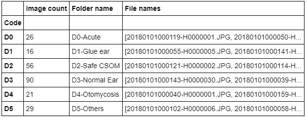
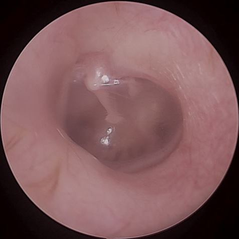
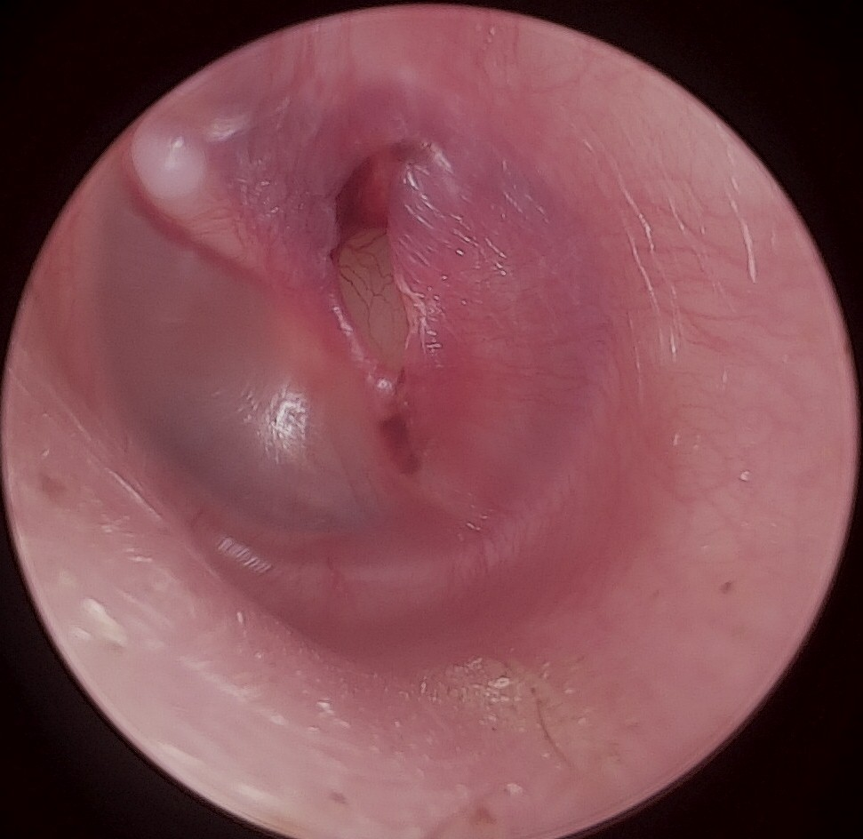
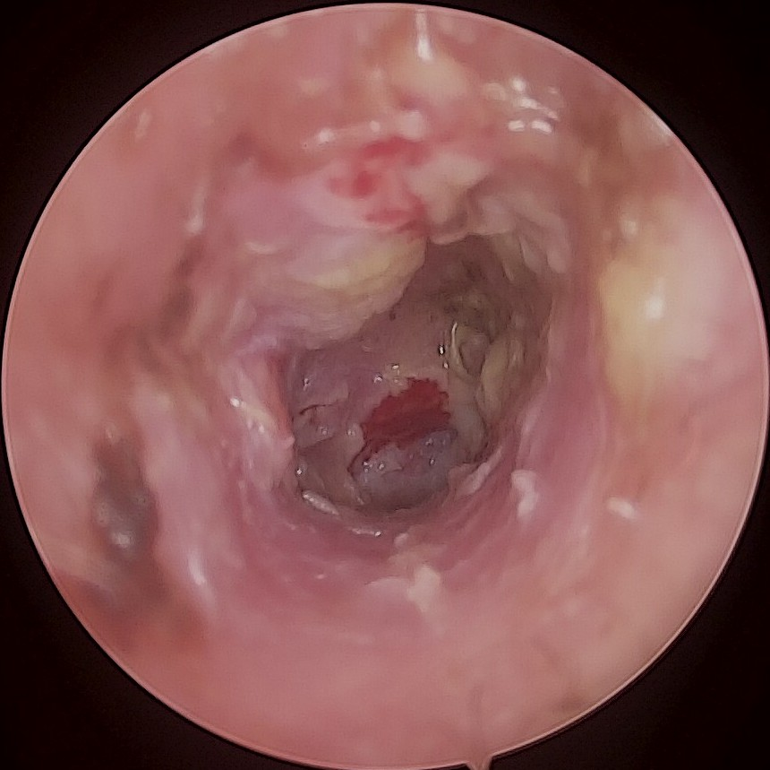
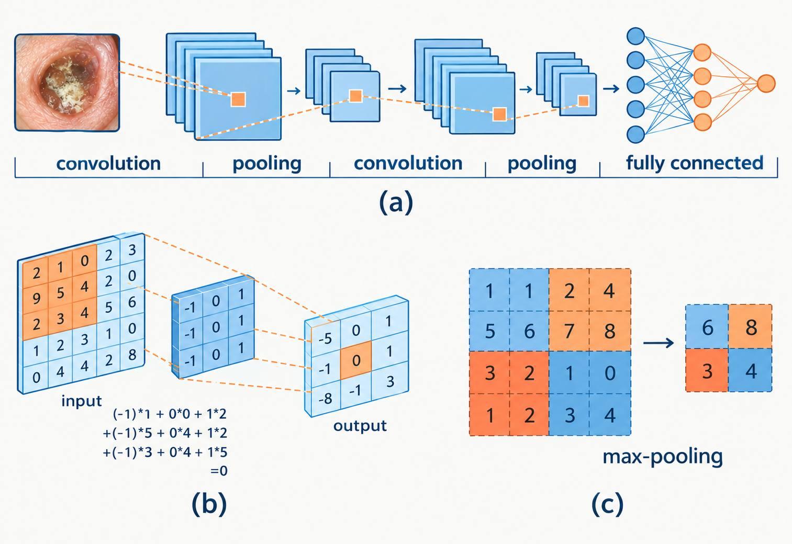
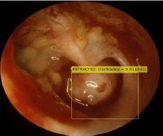
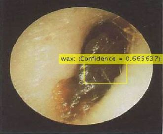

# Ear Disease Detection System

**Nawaloka Hospital PLC Research and Education Foundation (NHREF)**

A deep learning system that classifies otoscope images of the tympanic membrane
(ear drum) into seven conditions, intended as a screening aid for settings where
an ENT specialist is not immediately available.

> **Research use only.** Output from this system is a screening aid, not a
> clinical diagnosis, and must be reviewed by a qualified ENT practitioner.

## Background

Otitis Media (OM) is an infection of the middle ear. It is one of the most common
childhood illnesses and the second most important reason leading to loss of
hearing. It is most common in developing countries and was ranked fifth on the
global burden of disease, affecting 1.23 billion people in 2013.

OM is often misdiagnosed or not diagnosed at all, especially in its early stages.
It is either under-diagnosed or over-diagnosed depending on factors such as the
clinician, the presenting symptoms and the otoscope used. Reliable detection
requires an ENT practitioner, whose availability is limited in remote areas,
which is precisely where the condition goes untreated.

This project applies image classification to ear drum photographs so that a
survey volunteer can obtain a reliable indication of whether a patient should be
referred for professional assessment.

## Conditions Recognised

| Label | Condition |
| --- | --- |
| AOM | Acute Otitis Media |
| CSOM | Chronic Suppurative Otitis Media |
| Glue Ear | Otitis media with effusion |
| Otomycosis | Fungal ear infection |
| Wax | Impacted cerumen |
| Normal Ear | No abnormality detected |
| Others | Outside the trained categories |

## Dataset

The dataset was obtained from a practising ENT doctor and consists of
approximately 250 images across the classes above.



<table>
    <tr align="center">
      <td></td>
      <td></td>
      <td></td>
    </tr>
    <tr><td align="center">Normal Ear</td><td align="center">Glue Ear</td><td align="center">Otomycosis</td></tr>
</table>

## Approach

A convolutional neural network is used as the baseline classifier, implemented
with Keras over TensorFlow.



Because the dataset is small, the production model relies on **transfer
learning** rather than training from scratch:

- Take layers from a model already trained on a large corpus (ImageNet).
- Freeze them, so their learned features are not destroyed during training.
- Add new trainable layers on top that map those features to our classes.
- Train only the new layers on the ear drum dataset.

ResNet50 and InceptionResNetV2 were both initialised from ImageNet weights via
`keras.applications` and fine-tuned on the dataset. The training runs are in
[`notebooks/`](notebooks/).

> **Note on the shipped weights.** `models/my_model_44.h5` is a **MobileNetV2**
> network (3,576,903 parameters, 224×224×3 input, 7-way softmax output), not
> either of the architectures in `notebooks/`. The notebook that produced it is
> not part of this repository, so the two training notebooks document the
> approach rather than the exact artefact being served.

### Results

<p align="center">
<table>
    <tr>
      <td align="center"></td>
      <td align="center"></td>
    </tr>
    <tr><td align="center">Retracted Tympanic Membrane</td><td align="center">Wax</td></tr>
</table>
</p>

## Project Structure

```
.
├── app.py                  WSGI entry point (exposes `app`)
├── src/
│   └── ear_detection/
│       ├── api.py          Flask routes and application factory
│       ├── config.py       Paths, class labels, input size
│       ├── model.py        Model loading and prediction
│       └── preprocessing.py  Image loading, optional border cropping
├── frontend/
│   ├── index.html
│   ├── css/style.css
│   └── js/app.js
├── models/
│   └── my_model_44.h5      Trained Keras weights
├── notebooks/              Training notebooks
├── docs/images/            Figures used in this README
├── requirements.txt
├── Procfile / runtime.txt / uwsgi.ini    Deployment configuration
└── README.md
```

## Requirements

This project runs on **Python 3.9 to 3.11** with TensorFlow 2.15, which bundles
Keras 2.15. That combination keeps the `keras.preprocessing` API the code uses
and loads the original Keras 2.x weights in `models/` without conversion.

```bash
python -m venv .venv
source .venv/bin/activate     # macOS / Linux
.venv\Scripts\activate        # Windows

pip install -r requirements.txt
```

> On a slow connection, give pip more headroom. The TensorFlow wheel is
> around 300 MB and the default 15 s socket timeout can abort the install:
> `pip install -r requirements.txt --timeout 120 --retries 10`

## Running the Service

```bash
python app.py
```

The service starts on `http://localhost:5000` and serves both the API and the
web interface, so no separate static server is needed. Set `PORT` to listen
elsewhere.

### API

**`POST /api/v0.1/inference`**

Accepts a multipart form with a `file` field containing the otoscope image
(JPG, PNG or BMP).

| Query parameter | Default | Description |
| --- | --- | --- |
| `crop` | `false` | Trim the dark otoscope border before classifying |

```bash
curl -F "file=@ear.jpg" http://localhost:5000/api/v0.1/inference
```

```json
{
  "prediction": "Normal Ear",
  "confidence": 0.7234,
  "differential": [
    { "label": "Normal Ear", "probability": 0.7234 },
    { "label": "Wax",        "probability": 0.1757 },
    { "label": "Others",     "probability": 0.0445 }
  ]
}
```

`differential` carries all seven classes ordered from most to least likely and
sums to 1.0. `prediction` and `confidence` are the first entry, repeated at the
top level for convenience.

**`GET /api/v0.1/health`** returns `{"status": "ok"}`.

### Configuration

| Variable | Default | Description |
| --- | --- | --- |
| `PORT` | `5000` | Port the service listens on |
| `MODEL_PATH` | `models/my_model_44.h5` | Location of the trained weights |
| `UPLOAD_DIR` | `uploads/` | Where uploaded images are written |

## Deployment

`Procfile` and `uwsgi.ini` run the application under uWSGI, loading `app:app`
from the repository root:

```
web: uwsgi uwsgi.ini
```

## References

- https://core.ac.uk/download/pdf/161426117.pdf
- https://www.sciencedirect.com/science/article/pii/S2352396419304311
- https://arxiv.org/abs/1512.03385
- https://keras.io/api/applications/inceptionv3/

---

Nawaloka Hospital PLC Research and Education Foundation
