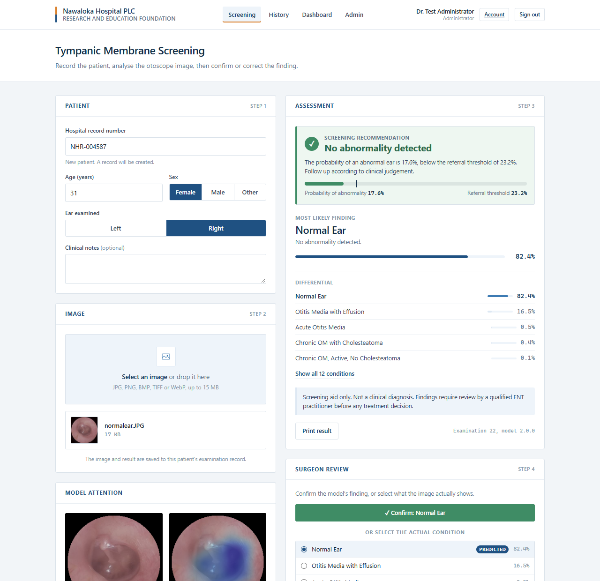

# Ear Disease Detection System

**Nawaloka Hospital PLC, Research and Education Foundation (NHREF)**

A screening aid for otoscope images of the tympanic membrane. It recommends
whether an ear should be referred for ENT review, names the most likely of
twelve conditions with a calibrated differential, and shows which regions of
the image the model relied on. Surgeons confirm or correct every finding;
those reviews measure real world performance on our own patients and feed a
supervised, approval gated retraining process.

> **Research use only.** This is not a medical device and has not been
> prospectively validated. Every result must be reviewed by a qualified ENT
> practitioner, and the system must never be used to withhold care.



## At a glance

Measured on 718 held out test images that were never used for training, model
selection or calibration:

| Measure | Result | 95% CI |
| --- | --- | --- |
| Abnormal ears referred (sensitivity) | **97.0%** | 95.1 to 98.2% |
| Normal ears not referred (specificity) | **75.6%** | 69.4 to 80.8% |
| AUROC, abnormal vs normal | 0.974 | |
| 12 condition macro F1 | 0.686 | |

Of 501 abnormal test ears, 15 were not referred; 11 of those were
myringosclerosis, which is usually benign. No cholesteatoma was missed. The full
breakdown is in the [validation report](docs/VALIDATION_REPORT.md), which is
generated from the model in service and also available inside the application.

## Getting started

Full instructions are in the **[Setup Guide](docs/SETUP_GUIDE.md)**. In short,
on Windows:

1. Install **PostgreSQL** (14 or later) and **Python 3.11**. Python 3.12 and
   later will not work, because TensorFlow 2.15 does not support them.
2. Double click **`setup.bat`**. It installs the dependencies, creates the
   database and a limited database user, writes the settings file and creates
   the first administrator.
3. Double click **`start.bat`** and sign in at <http://localhost:5000>.
4. Under **Admin**, add an account for each surgeon.

How to use the system day to day is in the **[User Guide](docs/USER_GUIDE.md)**.

## The clinical workflow

1. A surgeon **signs in** and enters the patient's hospital record number, age,
   sex and which ear was examined. No names are stored.
2. They upload the otoscope image and **run the analysis**. The result is saved
   to the patient's record with the date, time, clinician and model version.
3. They **review** the finding: confirm it with one click, select the actual
   condition from the list (the prediction is always first), or type a
   diagnosis that is not listed.
4. Every examination stays available in **History**, and the **Dashboard**
   shows how the model performs against the surgeons' verdicts.
5. An administrator can **retrain** once enough reviews exist. The candidate
   goes live only if it is at least as good as the current model and an
   administrator approves it.

## What a result shows

| Section | Meaning |
| --- | --- |
| **Screening recommendation** | *Refer for ENT review* or *No abnormality detected*, with the probability of an abnormal ear drawn against the referral threshold. |
| **Most likely finding** | The leading condition and its calibrated probability. Marked *low confidence* when the top two conditions are close. |
| **Chronic group** | The combined probability across all five chronic otitis media subtypes, more reliable than any one subtype. |
| **Differential** | Every condition, ranked, most likely first. |
| **Model attention** | The image as the model received it, and the regions that drove the finding tinted blue. |
| **Surgeon review** | Confirm, correct or enter another diagnosis; every verdict is kept. |

Uncertainty always resolves toward referral: if the model cannot confidently
call an ear normal, it recommends referral and says so. **Print result**
produces a one page summary for the patient's notes.

## Conditions recognised

| Condition | Description |
| --- | --- |
| Acute Otitis Media | Acute middle ear infection; bulging, erythematous tympanic membrane. |
| Otitis Media with Effusion | Fluid behind an intact tympanic membrane without acute infection. |
| Chronic Otitis Media | Chronic middle ear disease; subtype not recorded in the source data. |
| Chronic Suppurative OM | Persistent perforation with chronic discharge. |
| Chronic OM, Active, No Cholesteatoma | Perforation with active discharge and no cholesteatoma. |
| Chronic OM, Inactive | Dry tympanic membrane perforation without discharge. |
| Chronic OM with Cholesteatoma | Keratinising squamous epithelium in the middle ear; erosive. |
| Myringosclerosis | Calcified white plaques in the tympanic membrane; includes tympanosclerosis. |
| Cerumen Impaction | Ear wax occluding the canal or obscuring the tympanic membrane. |
| Otitis Externa | Inflammation of the external ear canal. |
| Other Findings | Foreign body, pseudomembrane or ventilation tube, pooled for lack of images. |
| Normal Ear | No abnormality detected. |

Otomycosis is **not** among them: the dataset contains no otomycosis images.
Surgeons can record it with *Other diagnosis*, which is how enough cases can be
collected to add it as a category later.

## Learning from the surgeons' reviews

This is supervised retraining on specialist verified labels, deliberately not
live or automatic learning. A model that updated itself from every click could
be degraded silently by a handful of mistaken reviews, with nobody noticing.
Instead:

1. Reviewed cases accumulate. Diagnoses entered as *Other* are kept but not
   trained on, since there is no category to learn them as.
2. An administrator starts a retraining run once at least 50 usable reviews
   exist. It runs in the background; the current model stays in service.
3. About 30 percent of reviewed **patients** are held out, so that both ears
   and repeat visits stay on one side of the split. The rest are added to the
   original training data.
4. Any uploaded image identical to an image in the frozen validation or test
   set is excluded from training, so the comparison cannot be contaminated.
5. The candidate is calibrated and tested exactly as the current model was,
   then both are scored on the held out local patients.
6. **The validation gate.** A candidate worse than the current model on the
   frozen test set or on the local patients cannot be approved.
7. A candidate that passes still waits for an administrator to **approve** it.
   Approval switches every user to the new model without a restart and
   regenerates the validation report. Each examination records the version
   that produced it.

The surgeons' reviews matter even without retraining: they are a running,
prospective measurement of performance on this clinic's patients and
equipment, which the public dataset results cannot provide.

## How the model works

1. **Field of view normalisation.** The image is cropped to its illuminated
   field, squared, resized to 224 pixels and masked to one fixed circle. The
   training data merges three source datasets that frame the ear differently;
   without this step the network learned to recognise the dataset rather than
   the ear. The same function runs at training and at inference.
2. **Classification.** MobileNetV2, initialised from ImageNet and fine tuned
   on 3,326 training images. It runs on an ordinary CPU in about a third of a
   second.
3. **Orientation averaging.** The prediction is averaged over all eight
   rotations and reflections of the image, so the result does not depend on
   how the otoscope was held. The test suite verifies this.
4. **Calibration.** Probabilities are temperature scaled so that a stated
   confidence matches an observed frequency.
5. **Referral threshold.** One minus the probability of a normal ear is
   compared with a threshold chosen on the validation split to refer 97% of
   abnormal ears.
6. **Explanation.** Because the network ends in average pooling and one linear
   layer, the class activation map comes from the same forward pass as the
   prediction, with no approximation.

## Data and validation

4,763 images in 16 folders from three public datasets were merged into 12
classes: `Ear wax` with `Cerumen_Impaction`, `tympanoskleros` with
`Myringosclerosis`, and three folders of fewer than 20 images each into
*Other Findings*. Two safeguards make the reported figures trustworthy:

- **No ear in both training and test.** One source is built from video, so the
  same ear appears in long runs of frames. Images were grouped by deep feature
  similarity and whole groups were assigned to one split. An earlier grouping
  by image hash left half of that source's test images with a near twin in
  training and overstated its accuracy; it was replaced.
- **Settings frozen before testing.** Model selection, calibration and the
  referral threshold all used the validation split. The test split was scored
  once, at the end.

## Known limitations

- **Retrospective, public data.** Performance on this clinic's otoscopes is
  unknown until it is measured on local images. The surgeons' reviews on the
  Dashboard are that measurement, and the most important evidence to gather
  before any clinical reliance.
- **Performance depends on the source.** Recall is highest on the largest
  source dataset. The results for the other two sources are the better guide
  to performance on unfamiliar equipment.
- **Single source classes.** Eight classes come from one source each, so their
  scores may still reflect acquisition style. Chronic Otitis Media
  (unspecified) scored perfectly and should not be quoted as diagnostic skill.
- **Small classes.** Other Findings, Otitis Externa and some chronic subtypes
  have under 20 test images; their figures are imprecise.
- **One image, one ear.** Clinical assessment draws on history, both ears and
  audiometry. This system sees a single image.

## Changing the referral policy

The referral threshold trades missed disease against unnecessary referrals.
Measured on the test split, with each threshold chosen on validation:

| Target sensitivity | Test sensitivity | Test specificity | Missed of 501 | Unnecessary referrals of 217 |
| --- | --- | --- | --- | --- |
| 90% | 90.0% | 87.1% | 50 | 28 |
| 95% | 95.0% | 78.3% | 25 | 47 |
| **97% (default)** | **97.0%** | **75.6%** | **15** | **53** |
| 99% | 99.0% | 72.8% | 5 | 59 |

To change it, run `python scripts/calibrate.py --target-sensitivity 0.99` (or
another value) and restart. Which conditions should trigger referral at all,
for example whether uncomplicated cerumen should be managed locally, is a
clinical decision for the supervising ENT surgeon.

## Security and privacy

**Patient data.** Patients are identified by hospital record number only;
names, dates of birth and contact details are never stored. Images are kept in
a storage folder outside the web root under random names, never under the
uploaded filename (clinic filenames often contain patient names), and are only
served to signed in users. Uploaded filenames are never logged or stored.
Results are marked `no-store` so browsers do not cache them.

**Accounts.** Passwords are hashed with scrypt and must be at least ten
characters mixing letters with numbers or symbols. New accounts receive a
temporary password that must be changed at first sign in. Five failed sign ins
lock an account for fifteen minutes. Users are signed out after thirty minutes
of inactivity. There are two roles: clinicians screen and review;
administrators also manage users, retraining and model approval.

**Sessions.** Sign in issues a short lived access token, held only in the
page's memory, and a refresh token in an httpOnly, SameSite Strict cookie
protected by a CSRF token. Changing or resetting a password, deactivating an
account or changing a role invalidates every open session for that user.

**Database.** The service connects as a dedicated PostgreSQL user that owns
only its own database; the superuser password is used once at setup and never
stored. Reviews are append only, and every sign in, examination, review,
account change and model approval is recorded in an audit log.

**Secrets** live in a `.env` file that is excluded from git. By default the
service only accepts connections from the computer it runs on. See the Setup
Guide for serving a clinic network over HTTPS, and for backing up both the
database and the image store.

## API

All endpoints except health and sign in require `Authorization: Bearer <token>`.

| Method | Path | Purpose |
| --- | --- | --- |
| `POST` | `/api/v1/auth/login` | Sign in; returns an access token and sets the refresh cookie. |
| `POST` | `/api/v1/auth/refresh` | New access token from the refresh cookie (needs `X-CSRF-TOKEN`). |
| `POST` | `/api/v1/auth/password` | Change your password. |
| `POST` | `/api/v1/examinations` | Multipart form: `record_no`, `age`, `sex`, `ear`, `notes`, `file`. Analyses and records. |
| `GET` | `/api/v1/examinations` | History, filterable by `q` and `status`, paginated. |
| `GET` | `/api/v1/examinations/<id>` | One examination with its result and reviews. |
| `GET` | `/api/v1/examinations/<id>/image/<kind>` | `original`, `view` or `overlay` image. |
| `POST` | `/api/v1/examinations/<id>/review` | `verdict` of `correct`, `corrected` (with `true_class`) or `other` (with `other_label`). |
| `GET` | `/api/v1/patients/<record_no>` | Whether a record number exists. |
| `GET` | `/api/v1/stats` | Performance against the surgeons' reviews. |
| `GET` | `/api/v1/model` | Model version, threshold, test results, classes. |
| `GET` | `/api/v1/health` | Service status. |
| | `/api/v1/admin/...` | Users, model versions, retraining, approval and the audit log. Administrators only. |

## Retraining from scratch

The in application retraining adds reviewed cases to the existing training
data. To rebuild everything, for example after adding a new condition folder
to `Dataset/` (and to `TAXONOMY` in `scripts/prepare_dataset.py`):

```bash
python scripts/prepare_dataset.py   # normalise, group by ear, split
python scripts/train.py             # about 40 minutes on a 4 core CPU
python scripts/calibrate.py         # calibrate, test once, write the report
python -m pytest                    # the full test suite
```

The class order is written to `artifacts/labels.json` and travels with the
weights, so a retrained model can never silently mislabel its outputs.

## Project structure

```
app.py                      Entry point; serves with Waitress
setup.bat, start.bat        One click setup and launch on Windows
.env.example                Settings template; setup writes the real .env
src/ear_detection/
    api.py                  Application factory and wiring
    auth.py                 Sign in, tokens, roles, password rules
    exams.py                Examinations, reviews, images, history
    stats.py                Performance against the surgeons' reviews
    admin.py                Users, model versions, retraining, audit log
    db.py                   Database schema
    analysis.py             Turning model output into a result
    model.py                Inference, calibration, attention maps
    imaging.py              Field of view normalisation, shared with training
    registry.py             Model versions and hot swapping
    retraining.py           Starting and monitoring retraining runs
    storage.py              Patient image storage
    reporting.py            Validation report rendering
    config.py               Settings, class names and descriptions
frontend/                   Web interface and the generated report page
models/ear_classifier.keras The model shipped as version 2.0.0
artifacts/                  Label order, split manifest, calibration, evaluation
scripts/                    manage, prepare_dataset, train, calibrate, retrain, report
tests/                      Authentication, examinations, administration, model, imaging, report
docs/                       Setup guide, user guide and validation report
notebooks/                  Experiments from the original prototype (historical)
```

## References

- Sandler M. et al. MobileNetV2: Inverted Residuals and Linear Bottlenecks. https://arxiv.org/abs/1801.04381
- Guo C. et al. On Calibration of Modern Neural Networks. https://arxiv.org/abs/1706.04599
- Zhou B. et al. Learning Deep Features for Discriminative Localization. https://arxiv.org/abs/1512.04150
- https://www.sciencedirect.com/science/article/pii/S2352396419304311

---

Nawaloka Hospital PLC, Research and Education Foundation
